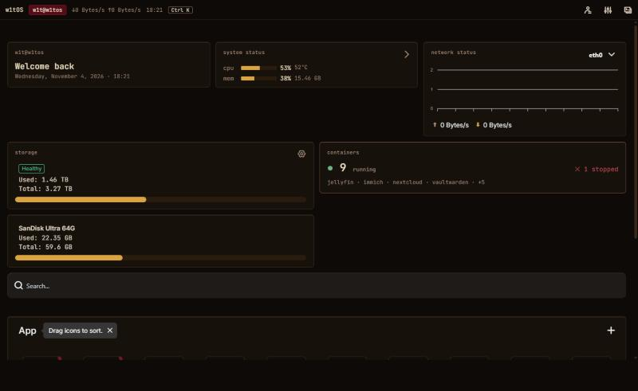
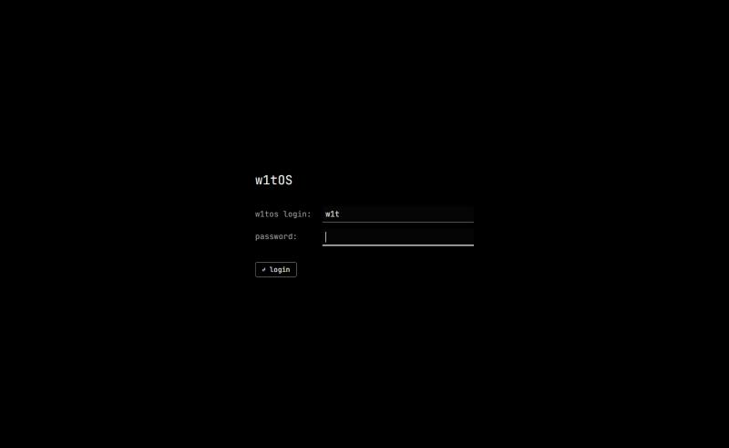
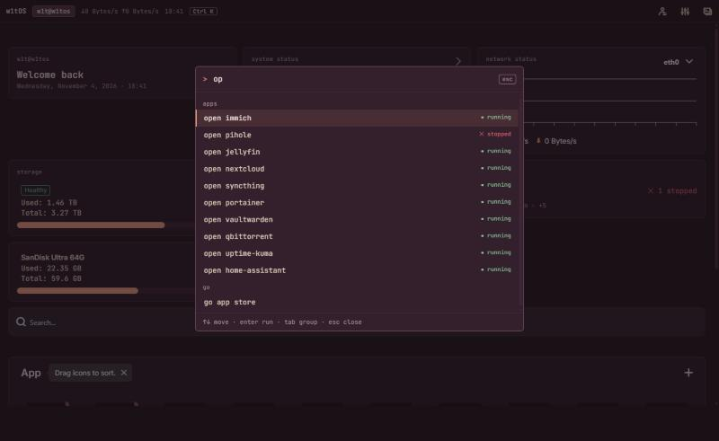
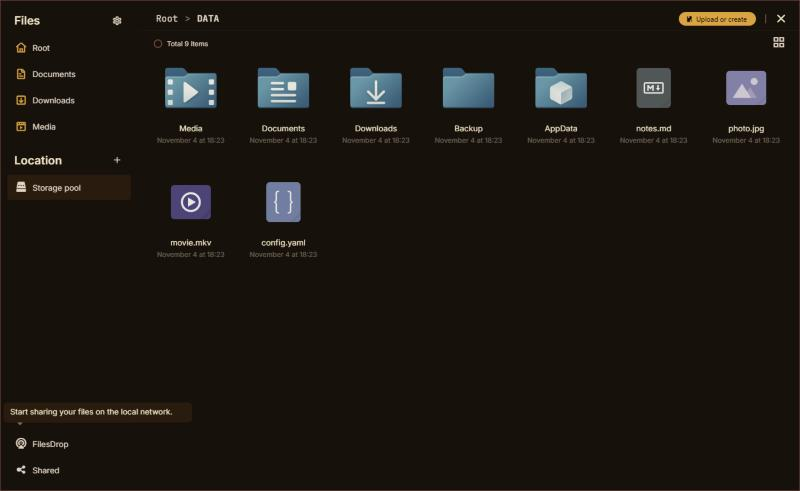
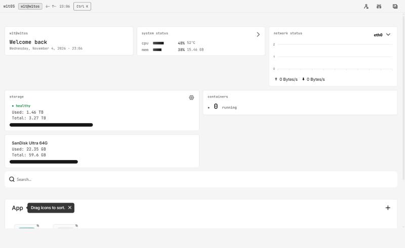
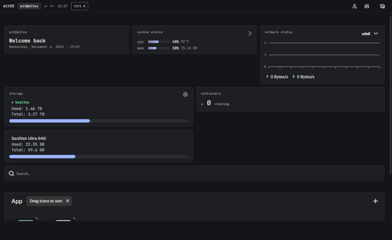

# w1tOS UI

A minimal, keyboard-first web interface for a home server running [CasaOS](https://github.com/IceWhaleTech/CasaOS).
It replaces only the web UI. The CasaOS backend, its APIs, Docker and your apps stay exactly as they are.



> **Status: early, single-maintainer project.** Everything below marked *tested* was checked in a browser against
> the bundled mock backend. It has **not yet been run against a real CasaOS server**, so expect rough edges there.
> See [What is and isn't tested](#what-is-and-isnt-tested).

w1tOS UI is an independent fork of [IceWhaleTech/CasaOS-UI](https://github.com/IceWhaleTech/CasaOS-UI) (Apache-2.0).
It is not affiliated with or endorsed by IceWhale. "CasaOS" is their name for their product.

---

## Why this exists

CasaOS is a good home-server backend, but its stock UI is built around wallpapers, blur, promos and a news feed, and its
build leaks the build machine's environment into the bundle. w1tOS keeps the backend and replaces only what you look at
and type into:

- **Calm.** Flat surfaces, three restrained themes, no wallpaper, no marketing. Status uses words and glyphs, not colour alone.
- **Fast to drive.** Everything common is one `Ctrl+K` away, and the layout follows the [Laws of UX](https://lawsofux.com)
  (large targets, short choice lists, typed confirmation for destructive actions).
- **Private.** No telemetry, no third-party feeds, nothing from the build machine in the shipped files.
- **Honest.** Nothing fake on screen: no sample apps, no placeholder images, no invented numbers. A fresh server looks empty.
- **Drop-in.** Static files that replace `/var/lib/casaos/www/`, with one-command rollback to the stock UI.

**Not a goal:** w1tOS is not an operating system or a backend fork. It does not change CasaOS's API, apps, storage or
Docker handling, and it does not add server features. The name is the interface's name; the OS underneath is whatever
your server already runs CasaOS on. Only English is shipped.

## What's different from the stock CasaOS UI

| Area | w1tOS UI |
|---|---|
| **Look** | Three themes, switchable instantly from Settings or the command palette: **Mono Dark** (default), **Mono Light** and **Royal Charcoal**. No wallpaper, no blur; every colour comes from one token set. |
| **Login / first run** | Terminal-style prompt (`w1tos login:`), Enter to submit, inline errors |
| **Dashboard** | Bento grid (12 / 6 / 1 columns) with a status line: `w1t@w1tos · ↓ ↑ rates · clock`. CPU and memory shown as text meters, plus a containers card. |
| **Command palette** | `Ctrl+K` / `⌘K` to open apps, go to Files / App Store / Settings, or restart / shut down (you type the word to confirm). |
| **Privacy** | No telemetry posted to the message bus, and no request to IceWhale's blog RSS feed. App icons are the only third-party requests left. |
| **Build safety** | Only `NODE_ENV` and `VUE_APP_*` reach the bundle. The stock build embedded the whole build-machine environment (paths, user names, any tokens). |
| **App Store** | Unchanged behaviour from CasaOS: Featured apps, categories, search, app details, one-click and custom (compose) install, and third-party store sources. Only the colours differ. |
| **Removed** | Wallpapers, the news feed, the Discord/feedback promos, the dashboard's recommended-app cards, and every language except English |

<table>
<tr>
<td></td>
<td></td>
</tr>
<tr>
<td align="center">Login</td>
<td align="center">Command palette</td>
</tr>
</table>



## What is and isn't tested

| Area | State |
|---|---|
| Production build, unit tests (`pnpm test`), env-leak check | ✅ passes, also in CI |
| Login, dashboard layout (1400 px, 900 px, 360 px with no horizontal scroll), Files, Settings menu, command palette | ✅ tested against the mock backend |
| App Store: Featured, categories, list, detail page, install request (same API calls as stock CasaOS), store-source input | ✅ tested against a temporary catalogue; the shipped mock has an empty store |
| Theme switching (all three themes: dashboard, Files, App Store, palette) | ✅ tested against the mock |
| Live stats and network rates (Socket.IO), terminal and logs, installing apps | ⚠️ not tested: needs a real server, because the mock has no socket |
| Signing in through Cloudflare Access, the deploy script, the server swap script | ⚠️ written, not yet run |

Known gaps and next steps, in order:
1. Run against a real CasaOS v0.4.5 server: live stats, terminal, logs, installs, then the deploy and swap scripts.
2. Favicons and home-screen icons are still the stock images.
3. The palette has no "logs / terminal for an app" action yet.
4. `color-mix()` needs a 2023-or-newer browser.

## Requirements

- A server running CasaOS. This UI is built from CasaOS-UI **v0.4.5** and expects that version's API; other versions may differ.
- To build: Node 22 LTS and pnpm 9.0.6 (`corepack enable` provides it)

## Try it locally, without a server

```bash
pnpm install
pnpm mock        # terminal 1: mock CasaOS API on 127.0.0.1:8090 (a clean install: no apps, empty store)
pnpm dev         # terminal 2: opens the UI; any username and password log in
```

Create `.env.dev.local` (git-ignored) so the dev server uses the mock:

```
VUE_APP_DEV_IP=127.0.0.1
VUE_APP_DEV_PORT=8090
```

## Develop against your own server

Point `.env.dev.local` at the machine that runs CasaOS: the IP and port you open its web UI at, **not** this computer.

```
VUE_APP_DEV_IP=192.168.1.50
VUE_APP_DEV_PORT=80
```

`pnpm dev` proxies `/v1` and `/v2`, WebSockets included, so everything is same-origin and there are no CORS issues.

## Build

```bash
pnpm build       # output: build/sysroot/var/lib/casaos/www/
pnpm test
```

## Install on the server

The UI is plain static files that replace `/var/lib/casaos/www/`. The included scripts swap it atomically and keep the
stock UI for rollback.

**One-time server setup.** Copy `scripts/w1tos-swap` to `/usr/local/bin/w1tos-swap`. Make it root-owned with mode 755, and allow only that script through sudo:

```
youruser ALL=(root) NOPASSWD: /usr/local/bin/w1tos-swap
```

**Deploy** (Windows PowerShell; needs SSH key access to the server):

```powershell
pnpm build
./scripts/deploy.ps1 -Server youruser@your-server
```

`deploy.ps1` refuses to upload if the bundle contains build-machine environment values. On the server:

```bash
sudo w1tos-swap rollback   # back to the previous deploy
sudo w1tos-swap stock      # back to the original CasaOS UI (kept from the first deploy)
```

Running a CasaOS update from its UI will probably reinstall the stock UI. If that happens, deploy again.

### Behind Cloudflare Tunnel + Access

- Add a cache rule that **bypasses cache** for the hostname. `/js/custom.js`, `/css/custom.css` and `favicon.ico` are not content-hashed, so Cloudflare would serve stale copies.
- The manifest link already uses `crossorigin="use-credentials"` so it loads behind Access.

## Customise

`src/config/brand.config.js` is the only file a fork needs to edit:

```js
module.exports = {
  osName: 'w1tOS',
  wordmark: 'w1tOS',
  user: 'w1t',
  host: 'w1tos',         // status line shows w1t@w1tos
  greeting: 'Welcome back',
  theme: 'mono-dark',    // default for new visitors; each viewer can switch in Settings
};
```

## Themes

| Mono Dark (default) | Mono Light | Royal Charcoal |
|---|---|---|
|  |  |  |

Switch in **Settings → Theme** or with `Ctrl+K` → `theme …`. The change applies instantly and is remembered per browser.
`brand.config.js` only sets the default.

| Token | Mono Dark | Mono Light | Royal Charcoal | Use |
|---|---|---|---|---|
| `--bg` / `--surface` / `--raised` | `#000000` `#0A0A0A` `#171717` | `#F5F5F5` `#FFFFFF` `#FFFFFF` | `#141518` `#1E1F22` `#2A2C30` | page, cards, modals |
| `--text` / `--text-soft` / `--muted` | `#F0F0F0` `#D4D4D4` `#A3A3A3` | `#0A0A0A` `#262626` `#525252` | `#F0F0F0` `#D4D4D6` `#A3A4A8` | headings, body, labels |
| `--accent` | `#FAFAFA` | `#171717` | `#9DB4FF` | buttons, focus ring, cursor, meters |
| `--line` / `--line-strong` | `#262626` / `#737373` | `#E5E5E5` / `#737373` | `#2F3135` / `#7D7F85` | borders / input edges |
| `--ok` / `--warn` / `--err` | `#4ADE80` `#FBBF24` `#F87171` | `#15803D` `#A16207` `#B91C1C` | `#6EE7A0` `#FCD34D` `#FB8A8A` | always paired with `●` / `▲` / `✕` |

Every theme passes WCAG AA: text is 16 to 18:1, labels at least 5.4:1, status colours at least 4.9:1 and input edges at
least 4.3:1. The mono themes use greyscale icons (app icons regain colour on hover). The neutrals come from the AAA grey
scale, Cyberminimalism and Royal Charcoal palettes, and Royal Charcoal adds a soft blue accent.

**How it works.** `scripts/brand.build.js` holds the themes. It writes the runtime CSS variables for each theme (selected by
`<html data-theme>`), the terminal palettes, and the Sass variables Bulma needs at compile time. Bulma bakes colours in
when it builds, so those Sass values are unique stand-in colours, and a small PostCSS step in `vue.config.js` rewrites
each one to its `var(--token)`. Components use tokens only. CI fails on any hard-coded colour outside the generated files.

## Project layout

```
src/config/brand.config.js     name, user@host, theme
scripts/brand.build.js         themes → CSS vars per theme, Sass stand-ins, terminal palettes
src/utils/theme.js             apply, switch and remember the theme at runtime
vue.config.js                  env whitelist, dev proxy, PostCSS stand-in → var(--token) rewrite
src/assets/scss/common/        _theme (global overrides), _bento (dashboard), _prompt (login)
src/components/palette/        command palette
src/components/bento/          containers card, text meter
mock/server.js                 local mock of the CasaOS API
scripts/deploy.ps1, w1tos-swap deploy and rollback
tests/                         node:test: theme contrast (WCAG AA), tokens, fuzzy search, text meter
```

## Contributing

See [CONTRIBUTING.md](CONTRIBUTING.md). Report security problems privately through a
[security advisory](https://github.com/w1tneess/w1tos-ui/security/advisories/new).

## License

Apache-2.0, the same as upstream. See [LICENSE](LICENSE) and [NOTICE](NOTICE). This is a modified version of
CasaOS-UI © IceWhale Technology, and the per-file upstream copyright headers are kept. Fonts are Inter and JetBrains Mono
(SIL OFL), installed from npm.
